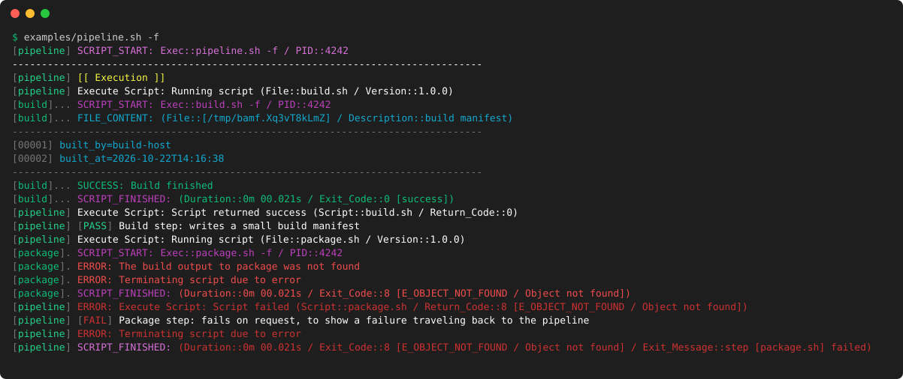
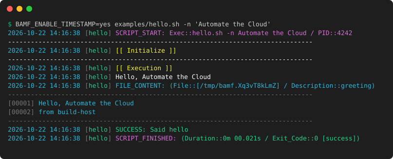

<p align="center">
  <picture>
    <source media="(prefers-color-scheme: dark)" srcset="brand_kit/logos/svg/bamf-stacked-dark.svg">
    
  </picture>
</p>

# BAMF: BASH Application Management Framework

BAMF is a library for bash scripts. You source one file, `bamf.inc`, and your script gets consistent logging, named exit codes, temporary files that are always cleaned up, dependency checks, signal handling, and a set of everyday helpers for strings, files, and configuration.

It started as one person's toolkit and grew over many years of production scripting: deployment hooks, CI pipelines, server setup, and the glue between them. Automate the Cloud publishes it for two reasons: so other people can write reliable scripts faster, and to show, in working code, the bash practices that make scripts dependable.

## A quick look

This is the core of [`examples/hello.sh`](examples/hello.sh), with the argument handling and the Initialize section left out:

```bash
#!/bin/bash
# purpose: A first BAMF script: logging, a temporary file, and a clean exit
# version: 1.0.0

SELF_IDENTITY="hello"
source "$(dirname "${BASH_SOURCE[0]}")/../bamf.inc" || exit 3

start_logic

line_break
log_highlight "Execution"
log "Hello, ${NAME}"

# Removed automatically when the script exits, however it exits
generate_temp_file FILE_GREETING "greeting"
printf 'Hello, %s\nfrom %s\n' "${NAME}" "$(return_hostname)" > "${FILE_GREETING}"
log_add_from_file "${FILE_GREETING}" "greeting"

log_success "Said hello"
exit_logic 0
```

Running it on a terminal:


When a script runs others, each child's lines use a softer palette and line up under the parent's. When something fails, the exit code says what went wrong, by name, all the way back up. Here [`examples/pipeline.sh`](examples/pipeline.sh) runs two steps, and the second one fails:



Every line names the script that wrote it, so the output of several scripts stays readable when they run one after another in a CI job or a deployment log. Color appears on a terminal; in a log file, CI job or cron mail, each line gets a timestamp instead:

```text
2026-10-22 14:16:38 [hello] SUCCESS: Said hello
2026-10-22 14:16:38 [hello] SCRIPT_FINISHED: (Duration::0m 00.021s / Exit_Code::0 [success])
```

Timestamps can be turned on for a terminal too, by whoever runs the script (`BAMF_ENABLE_TIMESTAMP=yes`) or in the script itself (`ENABLE_TIMESTAMP=yes`):



These images are made from the scripts' real output by [`ci/readme_images.sh`](ci/readme_images.sh), and CI checks they are current.

## What you get

- **Logging** that looks the same in every script: notices, warnings, errors, highlighted sections, file contents with line numbers, and timestamps when the output goes to a file. Each line is a single `printf`, with no subshells, so logging stays fast in loops.
- **Named exit codes.** `exit_logic "${E_OBJECT_NOT_FOUND}"` exits with 8, and the log says `E_OBJECT_NOT_FOUND / Object not found`. Define your own with `define_exit_code`.
- **A guaranteed ending.** `start_logic` traps signals and the end of the script, so temporary files are removed and the exit code is logged whether the script finishes, fails under `set -e`, or is stopped with Ctrl+C. Register your own cleanup with `add_exit_function`, and it runs on every one of those paths too.
- **Temporary files and directories** that are removed when the script exits, and only ever from inside the temporary directory.
- **Dependency checks** before any work starts: list the commands your script needs in `REQUIRED_EXECUTABLES`, and it stops with `E_MISSING_DEPENDENCIES` if one is missing.
- **Secrets kept out of logs.** Option values named in `SENSITIVE_ARGUMENTS` are masked in the start line, and `generate_temp_file_with_content` passes secrets to commands through a 0600 file instead of the command line, where any user could see them in the process list.
- **Configuration helpers** that read properties, dotenv, key/value, and simple YAML files into variables, and check that required values are set.
- **Helper files** for specific tools, loaded only by the scripts that need them (see [Helper files](#helper-files)).

## Requirements

- bash 4.2 or newer. The tests run on bash 4.2 (CentOS 7) and bash 5.2 (Debian 12, Amazon Linux 2023).
- GNU coreutils (`date`, `mktemp`, `stat`). Alpine and BusyBox are not supported.

Nothing else is needed for the core. A few functions use other common tools when you call them, such as `gzip`, `file`, or `uuidgen`, and say so in their description.

## Getting started

Copy `bamf.inc` (and any helper files you want) next to your scripts, or anywhere your scripts can find them. There is nothing to install.

A BAMF script follows the same shape every time:

```bash
#!/bin/bash
###------------------------------------------------------------------------------------------------
# script:  backup.sh
# purpose: Copies the application data to the backup volume
# version: 1.0.0
###------------------------------------------------------------------------------------------------

## Config
SELF_IDENTITY="backup"                  # optional, defaults to the script's file name
SENSITIVE_ARGUMENTS="p"                 # values of -p are masked in the log
ARGUMENTS_DESCRIPTION=(
    '-s <directory> : Source directory'
    '-p <password> : Archive password'
)

## Load BAMF
source "/opt/bamf/bamf.inc" || exit 3

## Dependencies
REQUIRED_EXECUTABLES+=( 'rsync' )
# REQUIRED_SOURCE_FILES+=( aws )        # helper files, by name

## Main
while getopts "hVs:p:" OPTION; do
    case "${OPTION}" in
        s) DIRECTORY_SOURCE="${OPTARG}";;
        p) ARCHIVE_PASSWORD="${OPTARG}";;
        h) usage; exit 0;;
        V) return_script_version "${0}"; printf '\n'; exit 0;;
        *) usage; exit "${E_BAD_ARGS}";;
    esac
done

start_logic

line_break
log_highlight "Initialize"
# check arguments and configuration here

line_break
log_highlight "Execution"
# do the work here; on any failure: exit_logic <exit code> "<message>"

log_success "Backup finished"
exit_logic 0
```

- **ShellCheck cannot see that `bamf.inc` reads `SELF_IDENTITY` and `ARGUMENTS_DESCRIPTION`**, and warns that they are unused (SC2034). Silence it on those lines with `# shellcheck disable=SC2034`, as the examples do, rather than for the whole file.
- **The header comments are read by BAMF.** `usage` prints the `# purpose:` and `# version:` lines, and `-V` prints the version.
- **`start_logic` comes after the arguments are processed**, so `-h` and `-V` work without starting the script.
- **Functions return an exit code.** Check it and end the script with it:

  ```bash
  load_property_from_file DB_HOST db.host "${FILE_CONFIG}"
  verify_array_key_values "REQUIRED_KEYS[@]" APP || exit_logic $?
  ```

- **Functions that produce a value take the name of a variable to put it in**, as their first or last argument (each function's description says which). Where that argument is optional, leaving it empty prints the value instead, so `$(trim "${VALUE}")` works too.

## Configuration

Set these in the environment when running a script. They override what the script itself sets.

| Variable | What it does |
|---|---|
| `BAMF_ENABLE_COLOR` | `yes` or `no`, to force color on or off. It wins over everything else. Without it, color is off when `NO_COLOR` is set; otherwise the script's own `ENABLE_COLOR` decides, and without that, color is on when the output is a terminal. |
| `BAMF_ENABLE_TIMESTAMP` | `yes` or `no`, to force the timestamp at the start of each log line on or off. Without it, the script's own `ENABLE_TIMESTAMP` decides, and without that, timestamps are on when the output is not a terminal (a log file, CI, cron, CodeDeploy) and off on a terminal. |
| `BAMF_LOG_IDENTITY_WIDTH` | The width of the `[script name]` column. Each line is padded with dots to it, so the messages line up. Defaults to the length of the script's name; `exec_script` passes its width on to the scripts it runs. Set it to line up the logs of several scripts that run separately. |
| `BAMF_LOG_DATE_FORMAT` | The format of the timestamp on each log line, in `strftime` form (for example `%H:%M:%S`, or `%Y-%m-%dT%H:%M:%S%z`). Defaults to `%Y-%m-%d %H:%M:%S`. A script can set its own default with `LOG_DISPLAY_DATE_FORMAT`. |
| `BAMF_DIRECTORY_TEMPORARY` | Where temporary files are created. Defaults to `DIRECTORY_TEMPORARY` if the script sets it, then `TMPDIR`, then `/tmp`. It must be an absolute path other than `/`, and it is created if it does not exist. |
| `NO_COLOR` | Any value turns color off, even in a script that sets `ENABLE_COLOR=yes`, unless `BAMF_ENABLE_COLOR` says otherwise. See [no-color.org](https://no-color.org). |

## Exit codes

Exit codes are numbers from 0 to 255, so BAMF divides the range:

| Range | Used by |
|---|---|
| 0–80, 251–255 | BAMF core: `E_BAD_ARGS` (5), `E_OBJECT_NOT_FOUND` (8), `E_MISSING_DEPENDENCIES` (7), and others |
| 81–120, 151–200 | BAMF core and helper files |
| 121–150 | bash itself and signals: 127 command not found, 130 Ctrl+C, 143 terminated |
| 201–250 | Your scripts |

Define your own, and the log will name them:

```bash
define_exit_code E_BACKUP_VOLUME_FULL 201 "The backup volume is full"
exit_logic "${E_BACKUP_VOLUME_FULL}"
# SCRIPT_FINISHED: (Duration::0m 01.204s / Exit_Code::201 [E_BACKUP_VOLUME_FULL / The backup volume is full])
```

`E_SUCCESS_ALT` (251) is for a script that succeeded but must still return a non-zero code, for example to tell a scheduler that there was nothing to do.

## Helper files

`bamf.inc` is everything most scripts need. For work tied to one tool or service, the [`helpers`](helpers) directory holds optional helper files, `bamf.<name>.inc`, that a script loads only when it uses them:

```bash
REQUIRED_SOURCE_FILES+=( aws docker )   # helpers/bamf.aws.inc, then helpers/bamf.docker.inc
start_logic
```

There are helpers for AWS, curl, Docker, Git, npm, package management, tar, and Terraform. [`helpers/README.md`](helpers/README.md) describes each one, how to write your own, and every function they provide.

## Bash practices in this code

BAMF is meant to be read as well as used. These are the techniques in it that are worth knowing for any bash script, and where to find them.

- **Return values with `printf -v`, never `eval`.** `printf -v "${NAME}" '%s' "${VALUE}"` stores any value in the variable named by the caller, exactly as it is. The common alternative, `eval ${NAME}="'${VALUE}'"`, runs the value as code, so a quote in a value read from a file can run commands. See `_bamf_return`.
- **Print with `printf '%s'`, not `echo`.** `echo` treats a value of `-n` or `-e` as an option and, depending on the shell, interprets backslashes. `printf '%s'` prints the value as it is.
- **`command -v` instead of `which`.** `which` is a separate program that some minimal images, including Amazon Linux 2023, do not install. `command -v` is part of bash.
- **Cleanup in an `EXIT` trap.** A trap on `EXIT` runs however the script ends. `exit_trap_ensure_graceful` uses it so a script that forgets `exit_logic`, or stops on an error under `set -e`, still cleans up and reports its exit code.
- **Delete only what you created.** `cleanup` removes only the files `generate_temp_file` recorded, and refuses anything outside the temporary directory, so a bad variable can never turn it into `rm -rf /`.
- **Keep secrets off the command line.** On most systems, every user on the machine can see a command's arguments with `ps`. Write a secret to a 0600 file and pass the file instead, as `generate_temp_file_with_content` does.
- **Works under `set -euo pipefail`.** Every optional argument is read as `${1:-}`, so the library works in scripts that treat unset variables as errors. Empty arrays are expanded as `"${ARRAY[@]+"${ARRAY[@]}"}"`, because before bash 4.4, `"${ARRAY[@]}"` on an empty array is an unbound variable error under `set -u`.
- **Guard every removal.** `rm -rf "${DIRECTORY}/${NAME}"` becomes `rm -rf /` if both variables are empty. `"${DIRECTORY:?}/${NAME:?}"` makes bash stop with an error instead. BAMF uses it wherever a path built from variables is removed.
- **A failed `$(...)` assignment ends a `set -e` script.** `WIDTH="$(tput cols)"` fails when there is no terminal type, as under cron, CI, and in containers. Give such assignments a fallback: `WIDTH="$(tput cols)" || WIDTH=""`.
- **Know the oldest bash you support.** In bash 4.2, `declare -gA NAME=()` inside a function creates the global array, but later assignments do not reach it. Declaring first and assigning separately works in every version. The tests run on bash 4.2 to catch differences like this one.
- **Read files with `while IFS= read -r LINE || [[ -n "${LINE}" ]]`.** `IFS=` keeps leading spaces, `-r` keeps backslashes, and the `||` test keeps a last line that has no newline at the end.

## Examples

The [`examples`](examples) directory holds complete scripts. Each teaches one idea, explains it in its comments, and is run by the test suite, so it keeps working.

| Example | What it shows |
|---|---|
| [`hello.sh`](examples/hello.sh) | The shape of a BAMF script: arguments, logging, a temporary file, and exit codes |
| [`config_check.sh`](examples/config_check.sh) | Reading a configuration file, checking every required value at once, your own exit code, and handing values to a CI pipeline |
| [`pipeline.sh`](examples/pipeline.sh) | One script running others in order, with a failing step's exit code traveling back |
| [`cleanup_and_signals.sh`](examples/cleanup_and_signals.sh) | Cleanup that runs however the script ends: success, an error under `set -euo pipefail`, or Ctrl+C (`add_exit_function`) |
| [`download_verify.sh`](examples/download_verify.sh) | Downloading with retries, checking a SHA-256 checksum before using the file, and extracting it |
| [`backup_to_s3.sh`](examples/backup_to_s3.sh) | Archiving a directory, encrypting it with a KMS key, and uploading it to S3 |
| [`codedeploy/`](examples/codedeploy) | A complete set of AWS CodeDeploy hooks for a containerized application: settings from SSM Parameter Store, Docker Compose, and a health check that stops a bad deployment |

## Contributing

Contributions are welcome, after review. Read [CONTRIBUTING.md](CONTRIBUTING.md) before opening a pull request, and report security problems as described in [SECURITY.md](SECURITY.md).

## Testing

The tests use [bats-core](https://github.com/bats-core/bats-core), and the code is checked with [ShellCheck](https://www.shellcheck.net). The CI scripts download pinned versions of both:

```shell
ci/install_test_dependencies.sh
ci/lint.sh
ci/test.sh                                        # with your bash
ci/test.sh centos:7 debian:12-slim amazonlinux:2023   # in containers, with Docker
```

## Function reference

Every function in `bamf.inc`, generated from the comments in the code (`ci/function_reference.sh -u` updates it). The helper files' functions are in [`helpers/README.md`](helpers/README.md).

<!-- BEGIN FUNCTION REFERENCE -->

<!-- Generated by ci/function_reference.sh from the FUNCTION comments in the code. Do not edit by hand. -->

### `bamf.inc`

BASH Application Management Framework (BAMF) core library

| Function | What it does | Arguments |
|---|---|---|
| `add_element_to_array` | Appends one or more elements to the array with the specified name | `$1` Array Name<br>`$2+` Element(s) |
| `add_exit_function` | Registers a function to run when the script exits, however it exits: exit_logic, an error under set -e, the end of the script, or a signal such as Ctrl+C. Use it to undo what the script set up outside the machine's temporary directory (a lock, a DNS record, a test resource in the cloud).<br>Functions run once each, the last registered first, before the temporary files are removed; BAMF_EXIT_CODE holds the code the script is exiting with. A failing function is logged and does not change the exit code.<br>Requires start_logic, which sets up the exit handling | `$1` Function name |
| `base64_decode` | Decodes a base64 string | `$1` Variable name to pass info to (optional, if not specified the decoded string is printed)<br>`$2` Encoded string |
| `base64_encode` | Encodes a string to base64 (single line, the string is encoded exactly as given) | `$1` Variable name to pass info to (optional, if not specified the encoded string is printed)<br>`$2` String |
| `base64_encode_and_compress` | Compresses a string (gzip -9) and encodes the result to base64 (single line)<br>Decode with: printf '%s' "${STRING}" \| base64 -d \| gunzip<br>Returns E_MISSING_DEPENDENCIES if gzip is not installed | `$1` Variable name to pass info to (optional, if not specified the encoded string is printed)<br>`$2` String |
| `call_sleep` | Sleeps for the specified number of seconds and logs it | `$1` Number of seconds to sleep<br>`$2` Reason (optional) |
| `call_sleep_random` | Sleeps for a random number of seconds between 1 and the specified maximum, and logs it | `$1` Max sleep time in seconds (optional, defaults to 60; 0 does not sleep) |
| `cleanup` | Removes the temporary files and directories created by generate_temp_file / generate_temp_directory<br>Only removes entries located beneath the temporary directory (or /tmp); anything else is skipped with a warning, for safety | none |
| `cleanup_quiet` | Same as cleanup, without logging | none |
| `color_lookup` | Prints the color definition for a color name (an unknown name is printed back unchanged) | `$1` color name (example: light_cyan) |
| `color_text` | Prints text gently swaddled in radiant color<br>The text is printed as-is (backslash sequences in the text are not interpreted)<br>When color is disabled (ENABLE_COLOR), the text is printed without color codes | `$1` color (example: "${COLOR_YELLOW}" or "$(color_lookup yellow)")<br>`$2` text<br>`$3` color to resume (optional, defaults to the log message color) |
| `debug_color_text` | Prints a test line in each of the defined colors (for debug purposes only) | none |
| `define_exit_code` | Defines a named exit code (declares the variable and registers it for lookup_exit_code)<br>Returns E_BAD_ARGS for an invalid definition, E_OBJECT_ALREADY_EXISTS if the number is used by another name | `$1` Name (must start with E_, example: E_MY_FAILURE)<br>`$2` Number (0-255)<br>`$3` Description (optional) |
| `does_array_contain_element` | Returns true if the array contains the element | `$1` Element string to search for<br>`$2+` Array (pass this way: "${array[@]}") |
| `echo_key_value` | Prints a [key]=value line, the format read by load_key_value_from_file (the key is lowercased) | `$1` key<br>`$2` value |
| `exec_script` | Runs another script as a child (inception?), which logs in the child color palette<br>Returns the exit code of the script that was run | `$1` Script to run<br>`$2+` Arguments to pass to the script |
| `exit_logic` | Ends the script: removes temporary files, logs the duration and exit code, restores the terminal<br>An exit code given but empty (exit_logic "${E_MISTYPED}") ends the script with E_UNKNOWN_EXIT_CODE, not 0: an unset variable must never turn a failure into a success. Quote the code, as in exit_logic "${E_BAD_ARGS}", so this check can see it; unquoted, an empty value disappears. | `$1` Exit code to return (optional, defaults to 0)<br>`$2` Exit message (optional) |
| `exit_logic_quiet` | Same as exit_logic, without logging | `$1` Exit code to return (optional, defaults to 0) |
| `exit_logic_skip_cleanup` | Same as exit_logic, but leaves the temporary files in place (useful for debugging) | `$1` Exit code to return (optional, defaults to 0)<br>`$2` Exit message (optional) |
| `exit_trap` | Exit logic for a caught signal (set up by start_logic) | `$1` Exit code to return<br>`$2` Exit message (optional) |
| `exit_trap_ensure_graceful` | Exit logic for the EXIT trap (set up by start_logic)<br>A safety net for a script that ends without calling exit_logic (or that stops on an error under set -e): the temporary files are still removed and the exit code is still logged | none |
| `explode_key_value_to_file` | Writes each element of a delimited string to a file as a [key]=value line<br>An element without "=" is written with the value "true" | `$1` File to write to<br>`$2` Delimited string (example: "name=web;port=443;debug")<br>`$3` Delimiter (optional, defaults to ";") |
| `file_update_owner` | Changes the owner of a file or directory | `$1` File or directory<br>`$2` Owner (example: apache:apache) |
| `file_update_permissions` | Changes the permissions of a file or directory | `$1` File or directory<br>`$2` Permissions (example: 0400) |
| `filesize_bytes_to_human_readable` | Converts a size in bytes to a human readable format (example: 1.50 MB) | `$1` Size in bytes (integer)<br>`$2` Variable name to pass info to (optional, if not specified the value is printed) |
| `function_exists` | Returns true if a function with the specified name exists | `$1` Function name |
| `generate_temp_directory` | Creates a temporary directory, which cleanup removes when the script exits<br>Exits the script (E_OBJECT_FAILED_TO_CREATE) if the directory cannot be created | `$1` Variable name to pass the directory name to<br>`$2` Purpose string (optional, shown in the log on failure)<br>`$3` Base directory (optional, defaults to DIRECTORY_TEMPORARY) |
| `generate_temp_file` | Creates a temporary file (mode 0600), which cleanup removes when the script exits<br>Exits the script (E_OBJECT_FAILED_TO_CREATE) if the file cannot be created | `$1` Variable name to pass the file name to<br>`$2` Purpose string (optional, shown in the log on failure)<br>`$3` Directory (optional, defaults to DIRECTORY_TEMPORARY) |
| `generate_temp_file_with_content` | Creates a temporary file (mode 0600) holding the content exactly as given (no newline added)<br>Use it to pass sensitive values to commands as file:// or fileb:// arguments, so they do not appear in the process list | `$1` Variable name to pass the file name to<br>`$2` Content<br>`$3` Purpose string (optional) |
| `generate_uuid` | Creates a random UUID, lowercase and without hyphens | `$1` Variable name to pass info to (optional, if not specified the value is printed)<br>`$2` Length (optional, truncates the 32 character string) |
| `is_empty` | Returns true if the value is empty<br>With strict checking (the default), the values 0 and 0.0 also count as empty | `$1` Value to check<br>`$2` Strict checking, yes or no (optional, defaults to yes) |
| `is_int` | Returns true if the value is an integer (an optional leading minus sign, then digits) | `$1` Value to check |
| `is_running_as_root` | Returns true if the script is running as root | none |
| `is_server_up` | Returns true if the server answers ping (3 attempts) | `$1` Server address |
| `json_escape` | Prints a string escaped for use inside a JSON string value (the surrounding quotes are not added)<br>Escapes backslashes, double quotes and control characters, so any value can be placed in JSON built by a script: printf '{"name": "%s"}' "$(json_escape "${NAME}")" | `$1` String |
| `json_extract_from_string` | Extracts the value of a key from a simple JSON string<br>Works best on flat JSON objects that do not repeat key names; for anything more complex, use a JSON tool such as jq. This exists so simple cases do not need jq installed. | `$1` Variable name to pass info to (optional, if not specified the value is printed)<br>`$2` Key name<br>`$3` JSON string |
| `json_safe` | Prints the string with characters that would break a JSON string value replaced<br>Newlines, single and double quotes become underscores; surrounding spaces are removed; non-ASCII characters are removed when iconv is available | `$1` String |
| `line_break` | Prints a line that spans the full width of the terminal<br>Serves no purpose other than to be a pretty, pretty princess<br>The width is looked up on first use and cached for the life of the script | none |
| `load_array_key_values_from_file` | For each key in the array, loads its value from a [key]=value file into an uppercase variable<br>Example: keys ('region') with prepend string APP set APP_REGION | `$1` Array (pass this way: "KEYS[@]")<br>`$2` File to load from<br>`$3` Prepend String (optional, an underscore is added automatically)<br>`$4` Parse String (optional, see load_key_value_from_file) |
| `load_array_key_values_from_yaml_file` | For each key in the array, loads its value from a YAML file into an uppercase variable<br>See return_yaml_string for the (simple) YAML that is understood | `$1` Array (pass this way: "KEYS[@]")<br>`$2` File to load from<br>`$3` Prepend String (optional, an underscore is added automatically) |
| `load_array_properties_from_file` | For each key in the array, loads its value from a properties file into an uppercase variable<br>Example: keys ('db.host') with prepend string APP set APP_DB_HOST | `$1` Array (pass this way: "KEYS[@]")<br>`$2` File to load from<br>`$3` Prepend String (optional, an underscore is added automatically) |
| `load_key_value_from_file` | Loads a value from a file of [key]=value lines (written by write_key_value_to_file)<br>With a parse string, reads [parse][key]=value lines instead<br>The key is matched exactly; when a key appears more than once, the last line wins | `$1` Variable name to pass info to (optional, if not specified the value is printed)<br>`$2` Key name<br>`$3` File<br>`$4` Parse String (optional) |
| `load_property_from_file` | Loads a value from a properties or dotenv style file (key=value lines)<br>Keys match without regard to case, and "." and "_" are interchangeable (db.host matches DB_HOST)<br>Spaces around "=" and a leading "export " are allowed; lines starting with # or ! are comments<br>Matching single or double quotes around the value are removed; when a key appears more than once, the last line wins | `$1` Variable name to pass info to (optional, if not specified the value is printed)<br>`$2` Key name<br>`$3` File |
| `log` | Prints a log line: [identity] message, with the name padded with dots to the width of the name column, so messages line up (see LOG_IDENTITY_WIDTH); a timestamp comes first when ENABLE_TIMESTAMP is on | `$1` Message<br>`$2` Message type (optional): NOTC notice, SUCC success, WARN warning, ERRO error, HIGH highlight, SSTR script start, SFIN script finished, SNFO script info, FILE file content, SCLI command line, QUIE quiet (not printed)<br>`$3` Message color override (optional) |
| `log_add_from_file` | Prints the content of a file to the log, with line numbers | `$1` File<br>`$2` Description of the contents (optional)<br>`$3` Maximum number of lines to print (optional, defaults to 1000) |
| `log_error` | Prints an error log line (prefixed with "ERROR: ") | `$1` Message<br>`$2` Message color override (optional) |
| `log_file_content` | Prints a single line of file content (line number 0 prints a separator line) | `$1` Line number<br>`$2` Line content |
| `log_highlight` | Prints a highlighted log line: [[ message ]] | `$1` Message |
| `log_load_color_child` | Loads the color palette for scripts run by another script (see exec_script) | none |
| `log_load_color_parent` | Loads the color palette for scripts run directly | none |
| `log_notice` | Prints a notice log line | `$1` Message<br>`$2` Message color override (optional) |
| `log_quiet` | Prints nothing (a placeholder for messages that are only useful while debugging) | `$1` Message |
| `log_status` | Prints a status log line: [identity] [PASS] message<br>PASS and SUCCESS are shown in the success color, FAIL and ERROR in the error color, anything else in the warning color | `$1` Status (example: PASS)<br>`$2` Message<br>`$3` Width to pad the [STATUS] to with dots, so statuses of different lengths line up (optional, defaults to no padding; 9 fits [SUCCESS] and [WARNING])<br>`$4` Message color override (optional) |
| `log_success` | Prints a success log line (prefixed with "SUCCESS: ") | `$1` Message<br>`$2` Message color override (optional) |
| `log_warning` | Prints a warning log line (prefixed with "WARNING: ") | `$1` Message<br>`$2` Message color override (optional) |
| `lookup_exit_code` | Prints the name and description of an exit code (example: E_BAD_ARGS / Bad or missing arguments)<br>Prints UNKNOWN for a code that has not been defined with define_exit_code | `$1` Exit code |
| `option_enabled` | Returns true if the variable with the specified name is set to y, yes, 1 or true (any case)<br>Usage: "if option_enabled VERBOSE; then" - NOTE: the argument is the variable name, not the variable (no $) | `$1` Variable name |
| `parse_yaml` | Prints a simple YAML file as name="value" lines, nested keys joined with underscores (example: "db:\n  host: x" prints db_host="x")<br>Handles maps of scalars indented by two spaces; lists and multi-line values are not supported | `$1` File to parse |
| `parse_yaml_to_file` | Writes the output of parse_yaml to a file | `$1` File to parse<br>`$2` Output file |
| `return_file_last_modify_timestamp` | Returns the last modification time of a file (UNIX timestamp)<br>Returns E_OBJECT_NOT_FOUND (and an empty value) if the file does not exist | `$1` File<br>`$2` Variable name to pass info to (optional, if not specified the value is printed) |
| `return_file_md5sum` | Returns the MD5 checksum of a file<br>Returns E_OBJECT_NOT_FOUND (and an empty value) if the file does not exist | `$1` File<br>`$2` Variable name to pass info to (optional, if not specified the value is printed) |
| `return_file_mime` | Returns the MIME type of a file (requires the file command)<br>Returns E_OBJECT_NOT_FOUND (and an empty value) if the file does not exist | `$1` File<br>`$2` Variable name to pass info to (optional, if not specified the value is printed) |
| `return_file_sha1sum` | Returns the SHA-1 checksum of a file<br>Returns E_OBJECT_NOT_FOUND (and an empty value) if the file does not exist | `$1` File<br>`$2` Variable name to pass info to (optional, if not specified the value is printed) |
| `return_file_sha256sum` | Returns the SHA-256 checksum of a file<br>Returns E_OBJECT_NOT_FOUND (and an empty value) if the file does not exist | `$1` File<br>`$2` Variable name to pass info to (optional, if not specified the value is printed) |
| `return_filesize_of_file` | Returns the size of a file in a human readable format (example: 1.50 MB)<br>Returns E_OBJECT_NOT_FOUND (and an empty value) if the file does not exist | `$1` File<br>`$2` Variable name to pass info to (optional, if not specified the value is printed) |
| `return_filesize_of_file_in_bytes` | Returns the size of a file in bytes<br>Returns E_OBJECT_NOT_FOUND (and an empty value) if the file does not exist | `$1` File<br>`$2` Variable name to pass info to (optional, if not specified the value is printed) |
| `return_header_string` | Returns the value of a "# <identifier>: <value>" comment line from a file (the first one found)<br>Example: return_header_string version "${0}" prints the "# version:" line of the script | `$1` Header identifier<br>`$2` File<br>`$3` Variable name to pass info to (optional, if not specified the value is printed) |
| `return_hostname` | Returns the host name | `$1` Variable name to pass info to (optional, if not specified the value is printed) |
| `return_parameter_string` | Returns the value of a "## <identifier>: <value>" comment line from a file (the first one found) | `$1` Parameter identifier<br>`$2` File<br>`$3` Variable name to pass info to (optional, if not specified the value is printed) |
| `return_script_purpose` | Prints the "# purpose:" header of a script ("unknown" if it has none)<br>A <file>.info file next to the script is read instead, when it exists | `$1` File (normally "${0}") |
| `return_script_version` | Prints the "# version:" header of a script ("unknown" if it has none)<br>A <file>.info file next to the script is read instead, when it exists | `$1` File (normally "${0}") |
| `return_variable_value` | Returns the value of the variable with the specified name, with runs of whitespace collapsed to a single space, without evaluating code or expanding globs<br>Returns E_BAD_ARGS (and an empty value) if the name is not a valid variable name | `$1` Variable name<br>`$2` Variable name to pass info to (optional, if not specified the value is printed) |
| `return_yaml_string` | Returns the value of a "key: value" line from a YAML file (the first one found, at any indent)<br>Matching quotes around the value are removed. Nested keys are not distinguished; use parse_yaml for those | `$1` Variable name to pass info to (optional, if not specified the value is printed)<br>`$2` Key<br>`$3` File |
| `run_silently` | Runs a command or function with its output hidden; the output is printed only if it fails<br>Variables set by a function run this way are kept (it does not run in a subshell)<br>If the command ends the script (for example through exit_logic), its output is not shown<br>Returns the exit code of the command | `$1+` Command and its arguments |
| `source_include` | Loads a file with source (once; a file that is already loaded is skipped)<br>A name without a slash loads a BAMF helper file: "aws" (or "bamf.aws.inc") loads bamf.aws.inc from the helpers directory next to bamf.inc, or from beside bamf.inc when the files are kept together<br>Exits the script (E_OBJECT_NOT_FOUND) if the file does not exist<br>Helper files are sourced inside this function: they must declare their variables with "declare -g" (a plain "declare" or "local" would be local to this function) | `$1` File or helper name |
| `start_logic` | Starts the script; call it once, after processing the arguments<br>Logs the start line (the command line, with SENSITIVE_ARGUMENTS masked)<br>Sets traps so the script always ends through exit_logic (signals, errors under set -e, or reaching the end of the script)<br>Loads the files listed in REQUIRED_SOURCE_FILES, in order<br>Checks that the commands listed in REQUIRED_EXECUTABLES exist (exits with E_MISSING_DEPENDENCIES) | none |
| `start_logic_quiet` | Same as start_logic, without the start log line | none |
| `sync_disks` | Flushes file system buffers (sync) and logs it | none |
| `time_elapsed` | Prints the time elapsed between two timestamps in microseconds (example: 1m 05.250s) | `$1` Start time (microseconds since the epoch, from: date +%s%6N)<br>`$2` End time (optional, defaults to now) |
| `timestamp_to_human_readable` | Prints a UNIX timestamp as YYYY-MM-DD HH:MM:SS TZ<br>Only the first 10 digits are used, so timestamps with subseconds (date +%s%6N) work too | `$1` UNIX timestamp<br>`$2` Force UTC, yes or no (optional, defaults to no) |
| `to_lower` | Prints a string in lowercase | `$1` String |
| `to_upper` | Prints a string in uppercase | `$1` String |
| `trim` | Prints a string with spaces removed from both ends (of each line, for a multi-line string) | `$1` String |
| `uptime_greater_than` | Returns true if the system has been up for longer than the specified number of seconds (Linux) | `$1` Seconds (optional, defaults to 300) |
| `usage` | Prints the help: usage banner, ARGUMENTS_DESCRIPTION entries and the common arguments | none |
| `usage_banner` | Prints the usage banner of a script (name, "# purpose:" and "# version:" headers) | `$1` File (normally "${0}") |
| `usage_normalized_arguments` | Prints the arguments every BAMF script is expected to support | none |
| `verbose_display_date` | Prints a log date timestamp truncated to YYYY-MM-DD HH:MM:SS | `$1` Timestamp |
| `verify_array_key_values` | Checks that the variable for each key in the array is set and not empty (logs a warning for each one that is not)<br>Example: keys ('region') with prepend string APP check APP_REGION<br>Returns E_OBJECT_NOT_FOUND if any is missing | `$1` Array (pass this way: "KEYS[@]")<br>`$2` Prepend String (optional, an underscore is added automatically) |
| `verify_dependencies` | Checks that every command in REQUIRED_EXECUTABLES can be found in the PATH<br>Exits the script (E_MISSING_DEPENDENCIES) if any is missing | none |
| `version_to_integer` | Converts a version string of up to four numbers (example: 1.2.3 or 2.4.10-1) to an integer that sorts the same way, each part up to 999 | `$1` Version string<br>`$2` Variable name to pass info to (optional, if not specified the value is printed) |
| `write_dotenv_value` | Appends a NAME=VALUE line to a dotenv file<br>dotenv files are read by most CI systems (GitLab artifacts reports dotenv, GitHub Actions GITHUB_ENV / GITHUB_OUTPUT, Jenkins readProperties) | `$1` dotenv file<br>`$2` Variable name<br>`$3` Variable value |
| `write_key_value_to_file` | Appends a [key]=value line to a file (read it back with load_key_value_from_file) | `$1` File<br>`$2` Key<br>`$3` Value |

<!-- END FUNCTION REFERENCE -->

## License

BAMF is licensed under the [Apache License 2.0](LICENSE). See [NOTICE](NOTICE) for the copyright notice.

The BAMF and Automate the Cloud names and logos, including everything in [`brand_kit/`](brand_kit/), are not covered by this license. See [`brand_kit/NOTICE.md`](brand_kit/NOTICE.md).

---

Maintained by [Automate the Cloud](https://automatethe.cloud), a Kentucky 501(c)(3) that teaches cloud infrastructure and helps nonprofits run theirs.
